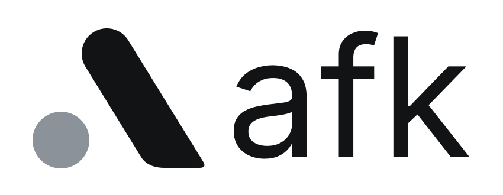
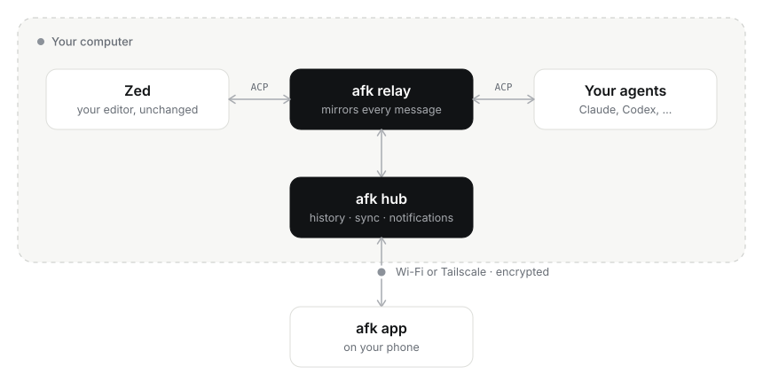

<p align="center">
  <a href="https://goafk.dev">
    <picture>
      <source media="(prefers-color-scheme: dark)" srcset="assets/brand/afk-logo-dark.svg">
      
    </picture>
  </a>
</p>

<p align="center"><strong>Away from keyboard, not away from control.</strong></p>

<p align="center">
  Your Zed agents, on your phone. This is the <strong>hub</strong>: the small piece that runs on your computer.
  <br>
  <a href="https://goafk.dev">Website</a> · <a href="https://goafk.dev/docs/">Docs</a> · <a href="https://github.com/goafk/app">Phone app</a>
</p>

<p align="center">
  <a href="https://goafk.dev/#film"></a>
  <br>
  <sub><a href="https://goafk.dev/#film">▶ Watch the full 35-second film, with sound</a></sub>
</p>

---

## What is afk?

You run AI coding agents (Claude, Codex) in [Zed](https://zed.dev). They work great, until they stop
to ask something: *"can I run the tests?"*, *"which option do you prefer?"*. If you've stepped away,
everything waits.

**afk puts Zed's agent panel on your phone.** Every thread on your computer shows up live on your
phone, and it works both ways:

- 🔔 **Get notified** when an agent needs permission, asks a question, or finishes.
- ✅ **Approve, answer and reply** from anywhere. The agent carries on in Zed.
- 💬 **Steer it**: send messages, queue the next step, switch model, mode or effort.
- 👀 **Watch it work**: plans, diffs, tool calls and code, exactly like in Zed.
- 💻 **Several computers**: personal and work, with one switch.

The hub is what makes this possible. It runs quietly in the background on your computer, keeps
Zed and your phone in sync, and sends the notifications. **No account, no cloud: your code and
threads stay on your machine.**

## Get started

**1. Install the hub** (takes about a minute):

```sh
curl -fsSL https://goafk.dev/install.sh | sh
```

It sets everything up and finishes by showing a **QR code**.

**2. Get the app** on your phone ([goafk/app](https://github.com/goafk/app)), open it and **scan the
QR code**. That's it.

> If setup asks, quit and reopen Zed once so the agents you already have open start syncing.

**What you need:** macOS with Zed, and Claude Agent and/or Codex added in Zed's Agent panel. An
Android phone (iPhone coming). [Tailscale](https://tailscale.com) is optional but recommended: it
lets your phone reach your computer from anywhere, not just on home Wi-Fi.

## Everyday commands

| Command | What it does |
| --- | --- |
| `afk pair` | Show a new QR code to pair another phone |
| `afk devices` | See which phones are paired (and remove one) |
| `afk status` | Check that everything is running |
| `afk setup` | Re-run setup (after adding a new agent in Zed, for example) |
| `afk uninstall` | Remove afk from Zed and stop the hub |

More in the [docs](https://goafk.dev/docs/).

## How it works

<p align="center">
  <picture>
    <source media="(prefers-color-scheme: dark)" srcset="assets/readme/how-it-works-dark.svg">
    
  </picture>
</p>

Zed talks to its agents over an open protocol (ACP). afk listens in on that conversation, so your
phone sees exactly what Zed sees, and can do what Zed does. There's no fork of Zed and nothing to
patch. If afk stops, Zed keeps working as normal.

## Privacy

- **Your Mac is the server.** There is no afk cloud, and your code never goes to one.
- **Each phone gets its own key** when you scan the QR code; you can revoke any of them with
  `afk devices revoke`.
- **Away from home**, the connection goes through Tailscale (encrypted, never exposed to the internet).
- **One caveat:** push notifications travel through Expo and Google, and contain the project name,
  the thread title and a short snippet. [Details](https://goafk.dev/privacy/).

## Contributing

Developer notes (CLI internals, HTTP API, how the relay works, tests) are in
[docs/DEVELOPMENT.md](docs/DEVELOPMENT.md).

## The afk repos

| Repo | What |
| --- | --- |
| **[goafk/hub](https://github.com/goafk/hub)** | This repo: the hub, the relay and the `afk` command |
| [goafk/app](https://github.com/goafk/app) | The phone app |
| [goafk/website](https://github.com/goafk/website) | [goafk.dev](https://goafk.dev) |

---

<sub>MIT licensed. afk is an independent project, not affiliated with Zed Industries.</sub>
